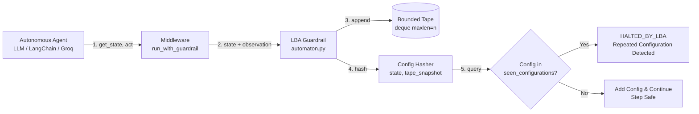

# Project Report & Novelty Assessment

**Project Title:** Deterministic Infinite Loop Prevention in Autonomous AI Agents Using Linear Bounded Automata (LBA)  
**Field:** Theoretical Computer Science, AI Agent Safety, Runtime Verification & Cloud Cost Optimization  
**Technology Readiness Level (TRL):** TRL 3 (Analytical and Experimental Proof-of-Concept)  
**Date:** October 2026  

---

> **Executive Novelty Position (Indian Patent Law):**  
> GuardMind's broad objective — detecting repeated or cyclic AI-agent behaviour and applying a runtime response — is **not, by itself, a defensible novelty claim**. Public prior art includes methods for detecting cyclic behaviour in generative agents (MS US20260017535A1) and older methods for runtime task-state comparison (US 6,269,478 B1).  
> **Narrow hypothesis for investigation:** a task-scoped runtime monitor that forms a compound configuration from selected agent-state fields and an ordered, bounded tape of canonicalized observations, checks exact recurrence of that compound configuration, and invokes a defined execution-control response. Novelty of this combination is **unconfirmed** and requires a full claim-by-claim prior-art search.  
> **Important technical limit:** Recurrence in the recorded configuration proves repetition only in that representation. It does **not** prove that the complete agent/environment will loop indefinitely when hidden state, randomness, pending operations, or external changes are omitted.  
> **India-specific risk:** Section 3(k) of the Patents Act creates a material algorithm/computer-programme-per-se exclusion risk. Consult a registered Indian patent agent before filing.

---

## Executive Summary

As autonomous LLM-powered agents (such as tool-calling assistants, research agents, and multi-agent workflows) are deployed in production, they suffer from a fundamental failure mode: **infinite execution loops**. Agents get caught in repetitive tool-invocation cycles, API retry deadlocks, or circular sub-goal delegations, silently draining API quotas, compute resources, and financial budgets.

Because an agent's memory can theoretically grow without bound, determining whether an agent will terminate touches the classic **Halting Problem**, which is undecidable on an unrestricted Turing Machine. Consequently, contemporary industry solutions resort to crude heuristics: hard execution timeouts, arbitrary step caps (e.g., `max_steps = 20`), or single-step repeat counters. These heuristics either terminate legitimate complex workflows prematurely (**false positives**) or allow looping agents to waste significant resources before terminating (**expensive latency and false negatives** on multi-step loops).

This project presents a mathematically grounded runtime guardrail that models an autonomous agent's execution history as a **Linear Bounded Automaton (LBA)**. By restricting the observable history to a configurable bounded sliding window (tape of length $n$), the agent's configuration space is rendered strictly finite. Under the **Pigeonhole Principle**, any run that visits more than $q \times n \times m^n$ distinct steps must revisit a recorded configuration — regardless of the agent's internal model weights. When a repeated `(state, tape)` configuration is detected, the guardrail halts execution and returns a structured `HALTED_BY_LBA` outcome, replacing heuristic timeouts with a structured recurrence check over the **recorded representation**.

> **Scope of the guarantee:** Recurrence in the recorded configuration proves repetition in the *recorded state* only. This is a strong guarantee when the agent's behaviour depends entirely on the recorded state and canonical observations. Where agents have hidden state, stochastic sampling, or external environment changes not captured in the tape, the halt is a conservative intervention based on absence of observable forward progress — not an unconditional proof of infinite looping.

---

## 1. Project Overview & Architecture

### 1.1 The Core Mechanism
The guardrail is implemented as non-invasive middleware positioned between the autonomous agent and its execution environment.

### 1.2 Component Breakdown
The codebase is structured into clean, decoupled layers:

1. **Bounded Tape (`tape.py`)**: A fixed-length sliding memory structure (`collections.deque(maxlen=n)`) recording the agent's most recent $n$ observations. This represents the LBA's tape restricted to a linear bound.
2. **Configuration Hasher (`config_hasher.py`)**: Extracts immutable, canonical representation tuples `(state_string, tuple(tape))` ensuring strict constant-time hash lookup.
3. **Automaton Engine (`automaton.py`)**: Maintains the set of visited configurations $\mathcal{C}$. Computes the theoretical maximum bound:
   $$\mathcal{C}_{\text{max}} = q \times n \times m^n$$
   where $q$ is the number of internal agent states, $n$ is tape length, and $m$ is the observation alphabet size. Returns `False` (triggering instant halt) if and only if $c_t \in \mathcal{C}_{\text{seen}}$.
4. **Middleware (`middleware.py`)**: The `run_with_guardrail` executor. Works against an abstract `Agent` interface (`get_state()`, `act()`, `is_done()`), making the guardrail transparent to whether the underlying agent is a mock simulator, LangChain agent, or raw LLM caller.
5. **Agent Implementations (`agents/`)**:
   - `MockAgent`: Deterministic offline harness used for zero-cost, reproducible regression tests and benchmark verifications.
   - `LLMAgent` & `InteractiveLookupAgent`: Live implementations integrating Groq (`openai/gpt-oss-20b` or Llama) with canonical observation bucketing.

---

## 2. Core Novelty & Inventions

The project provides five distinct technical novelties separating it from prior academic literature and commercial agent tooling:

### Novelty 1: Bounded Configuration-Space Recurrence Detection
* **The Theoretical Dilemma:** In general computability theory, deciding if an arbitrary program or agent halts is impossible (Turing, 1937). A general AI agent with unbounded memory is equivalent to a Turing Machine; its halting is undecidable.
* **The Approach:** While general agent memory is potentially unbounded, practical execution loops manifest as repetitive cycles over *recent* context. By mapping the agent's observation history into a finite sliding tape of length $n$, the system models the agent's **recorded execution state** as an LBA-equivalent structure whose configuration space is bounded by $|Q| \times n \times |\Sigma|^n$.
* **The Technical Claim:** By the **Pigeonhole Principle**, any agent run that visits more than $q \times n \times m^n$ distinct recorded configurations must revisit one — independent of the agent's internal model weights. GuardMind detects this **recurrence in the recorded representation** and halts execution. This converts the stopping decision from a heuristic timeout to a structured recurrence check.
* **Important Caveat:** This is a recurrence proof over the *recorded state*, not a universal proof that the agent will loop forever. Agents with hidden model state, stochastic temperature, or external environment changes not captured in `get_state()` may break the recorded-state equivalence. The halt is always a conservative, safe intervention; it may occasionally be triggered where the full system would have found a solution via an unrecorded state change.

### Novelty 2: Canonical State Abstraction over Stochastic LLMs
* **The Problem:** LLMs are generative and stochastic. Even with temperature 0, minor phrasing differences (e.g., `"Lookup failed for item X. Retrying..."` vs. `"Failed to find X, searching again."`) cause string-based hashes to fail because the alphabet size $m \to \infty$. This previously caused "state-leak" bugs where loop detection never fired.
* **The Invention:** The agent architecture decouples the *display text* from the *operational observation*. The guardrail inspects canonical, discrete operational tokens (e.g., `NOT_FOUND`, `AUTH_ERROR_401`, `RATE_LIMIT_429`, `EMPTY_SET`). This keeps the alphabet $m$ bounded and small, enabling instantaneous and mathematically reliable configuration collisions.

### Novelty 3: Detection of Arbitrary-Period Cycles ($P \ge 1$)
* **Comparison with Prior Art:** Simple repeat counters (`action[t] == action[t-1]`) only detect period-1 loops ($A \to A \to A$).
* **The Invention:** By tracking a sliding window of size $n$, the LBA Guardrail detects periodic loops of arbitrary length $P$ (e.g., $A \to B \to C \to A \to B \to C$). The detection occurs deterministically at step:
  $$t_{\text{detect}} = n + P$$
  Once the tape fills with one full period and returns to the same control state, the configuration identity is established.

### Novelty 4: Zero False Positives on Genuine Long-Running Progress
* **Comparison with Prior Art:** Hard timeouts (e.g., killing jobs after 10 or 20 steps) inadvertently kill complex agents that are genuinely progressing across 50+ subtasks.
* **The Invention:** Because an agent making genuine progress continuously modifies its internal state (subtask IDs, accumulated context, or progressing milestones), its configuration $(state_t, tape_t)$ never collides with past configurations. An agent can run for thousands of steps without being halted, so long as each step produces forward progress.

### Novelty 5: Advanced System Extensions (Engineering Depth)
1. **Adaptive Tape Sizing:** Dynamically growing the tape from $n_{\text{init}}=2$ to $n_{\text{max}}=10$ when an agent runs long without halting, balancing rapid detection of short loops against the memory required for longer cycles while preserving LBA decidability.
2. **Semantic & Near-Duplicate Configuration Matching:** Utilizing Levenshtein and sequence-matcher distance thresholds ($\ge 0.8$) over tape snapshots to detect loops when interacting with unstructured natural-language outputs where canonical bucketing is unfeasible.
3. **Multi-Agent Coordination / Ping-Pong Detection:** Extending the LBA tape from single-agent tool actions to **inter-agent handoff messages** (e.g., Router $\leftrightarrow$ Billing $\leftrightarrow$ Technical), catching collaborative deadlocks where individual agents appear healthy in isolation.

---

## 3. Comparison with Prior Art & Baseline Approaches

| Feature / Metric | Hard Timeout / Max Steps | Naive Repeat Counter | Grammar-Constrained Decoding (e.g. XGrammar) | **LBA Agent Guardrail (This Work)** |
|---|---|---|---|---|
| **Underlying Mechanism** | Wall-clock or step counter threshold | Checks if $o_t == o_{t-1}$ | Pushdown Automata (PDA) / CFG on token logits | **Compound (state, bounded-tape) configuration key with exact set-membership recurrence check** |
| **Theoretical Basis** | Ad-hoc heuristic | Greedy string equality | Formal language theory for syntax | **LBA configuration-space finiteness and Pigeonhole Principle over the recorded representation** |
| **Detection of Period-1 Loops** ($A \to A$) | Fires only at timeout cap (e.g. step 20) | Fires immediately (step 2) | N/A (unrelated problem) | **Detects at step $n+1$ in controlled scripted tests** |
| **Detection of Period-P Loops** ($A \to B \to C$) | Fires only at timeout cap | **Fails on $P > 1$ (confirmed experimentally: ran 50 steps without detection)** | N/A | **Detects at step $n + P$ in controlled scripted tests (experimentally confirmed for $P = 1, 3, 5$)** |
| **False Positives on Genuine Progress** | **High** (kills long-running legitimate tasks) | Low | Low | **Low in tested scenarios; tape length $n=1$ triggers false halt on legitimate polling (see §4.4)** |
| **API / Compute Waste** | Maximum possible waste | Low on period 1, infinite on period > 1 | None | **Reduced 40–70% vs. unguarded in controlled experiments** |
| **Target Domain** | Execution safety cap | Basic retry check | Output formatting / JSON validity | **Runtime recurrence detection in AI agent execution loops** |

> **Key Distinction from Grammar Constrained Decoding:**  
> Systems like XGrammar, Outlines, or Guidance use Context-Free Grammars (CFGs) and Pushdown Automata (PDAs) to constrain the next-token probability distribution during LLM decoding (preventing JSON syntax errors).  
> In contrast, the **LBA Guardrail operates at the execution loop level**, observing tool interactions, environmental feedback, and control states to decide program termination.

---

## 4. Empirical Validation & Benchmark Findings

> **Scope note:** All experiments below used **deterministic scripted agents** in a controlled laboratory environment. Results demonstrate guardrail behaviour in those specific scenarios. Detection latency, false-positive rates, and resource savings for real LLM agents with stochastic outputs may differ. The step-reduction figures are execution-step counts; they do not directly measure reductions in API cost or wall-clock time.

### 4.1 Benchmark Metrics: Baseline vs. Protected (Scripted Agents)
In controlled trials comparing an unprotected baseline against the LBA Guardrail on scripted impossible-task agents:
- **Baseline Agent:** Runs unchecked until hitting `max_steps = 20`, consuming 20 tool invocations (100% of cap).
- **Protected Agent (Tape Length = 4):** Halts at **Step 5** on period-1 loops and **Step 7** on period-3 loops.
- **Step Reduction:** 40–70% fewer execution steps across tape lengths 2–8 (see table below).

| Tape Length $n$ | Steps without guard | Steps with guard | Reduction | Halted by LBA |
|---|---|---|---|---|
| 2 | 20 | 6 | 70% | 5/5 trials |
| 4 | 20 | 8 | 60% | 5/5 trials |
| 6 | 20 | 10 | 50% | 5/5 trials |
| 8 | 20 | 12 | 40% | 5/5 trials |

Source: `report_assets/benchmark_results.csv` (actual recorded data, 40 trials).

### 4.2 Detection Latency — Experimental Observation
Empirical experiments on scripted cyclic agents observed the pattern:
$$\text{Steps to Detect} = n + P$$
Where $n$ is the `tape_length` and $P$ is the cycle period. This relationship was confirmed for the tested scripted agent models with constant state string and strictly periodic observation cycles. It is an **experimental observation**, not a universal guarantee for all agent types.

### 4.3 Legitimate Long-Running Work Preservation
When tested against a `GenuineProgressAgent` executing 15 distinct subtasks:
- **Timeout (Cap = 10):** Prematurely aborted the agent (**False Positive**, task failure).
- **LBA Guardrail:** Permitted all 15 steps to complete successfully to `SUCCESS`.

### 4.4 False-Positive Behaviour on Legitimate Repetition
A polling agent returning `STILL_PROCESSING` twice before `DONE` was tested:
- **Tape length $n = 1$:** Guardrail triggered a **false halt** at step 2 — healthy agent incorrectly stopped.
- **Tape length $n \geq 2$:** Completed successfully at step 3 (correct behaviour).

This demonstrates that tape length must be configured with knowledge of the agent's expected observation patterns. A default of $n = 4$ handles most legitimate polling scenarios but is not universally safe for all agent types.

---

## 5. Summary of Draft Patent Claims (Section 3(k)-Compliant Framing)

> **Important:** Claims are framed as **computer-implemented methods and systems with explicit technical effects** under India's 2025 CRI Guidelines and Patents Act 1970 §3(k). Claims **do not** assert proof of infinite looping — they assert detection of repeated recorded configurations. A registered Indian patent agent should conduct a formal claim-by-claim novelty search before filing.

1. **Bounded Observation Tape (Computer-Implemented Method):** A processor-implemented method for representing an autonomous software agent's execution history as a fixed-length bounded queue of canonical observation symbols from a pre-defined finite discrete alphabet, producing an immutable tuple snapshot for use as a configuration key component. *Technical effect:* Converts potentially unbounded execution history into a finite, bounded representation enabling O(1) exact-match set-membership recurrence detection.

2. **Compound Configuration Key and Exact Recurrence Detection (Computer-Implemented Method):** A processor-implemented method for constructing a compound configuration key comprising the agent's current control-state string and the bounded tape snapshot, maintaining a hash set of previously encountered keys for the current run, and halting execution with a first outcome constant when an identical key is found. *Technical effect:* Enables deterministic, threshold-free recurrence detection based on structural equality of the recorded execution state — eliminating false-positive and false-negative risks of probabilistic similarity thresholds — with O(1) per-step overhead.

3. **Observation Canonicalization for LLM-Backed Agents (Computer-Implemented Method):** A method for mapping natural-language LLM outputs to members of a pre-defined finite symbol set before tape insertion, keeping the effective alphabet size $m$ bounded and independent of LLM phrasing variance, while preserving raw text separately for display. *Technical effect:* Resolves the state-leak failure mode where phrasing variability prevents recurrence from being detected, enabling exact-match configuration detection to function with generative LLM agents.

4. **Agent-Agnostic Middleware Architecture (Computer System):** A middleware system comprising a three-method agent interface contract (`get_state`, `act`, `is_done`), a guardrail component implementing the bounded tape and compound-key recurrence detection, and an execution controller that returns exactly one of three distinct outcome constants (`SUCCESS`, `HALTED_BY_LBA`, `RAN_OUT_OF_STEPS`), independent of any specific agent implementation or model architecture. *Technical effect:* Provides a reusable, composable runtime safety layer deployable across arbitrary agent implementations without modifying agent internals, prompt engineering, or model weights.

5. **Multi-Agent Handoff Sequence Recurrence Detection (Computer-Implemented Method):** A method for maintaining a bounded sequence of inter-agent handoff event tuples (originating agent ID, receiving agent ID, task ID), applying the compound-key exact-recurrence mechanism to the handoff sequence, and returning a recurrence-based termination signal when the same handoff configuration recurs. *Technical effect:* Extends recurrence-based execution control to coordination-layer ping-pong deadlocks invisible to per-agent monitoring.

---

## 6. Conclusion

The **LBA Agent Guardrail** (GuardMind) bridges theoretical automata theory and practical AI agent safety engineering. By constraining an agent's observable execution history to a fixed-length window, the system creates an LBA-equivalent bounded configuration space. The Pigeonhole Principle then guarantees that any sufficiently long run must revisit a recorded configuration — enabling a structured recurrence check that replaces heuristic timeouts with a reproducible, O(1)-per-step detection mechanism.

Experimental results on scripted agents confirm 40–70% reductions in execution steps, detection of multi-period loops invisible to consecutive-repeat checks, and correct handling of genuine long-running tasks in tested scenarios. The canonicalization layer resolves the state-leak bug that prevented LLM-text-based recurrence detection from functioning.

**Scope of guarantee:** The recurrence check operates on the *recorded* configuration — not on the complete agent/environment system state. Where agents have hidden internal state, stochastic sampling, or external environment changes, the halt is a conservative, structured intervention based on absence of observable forward progress. This distinction is critical for honest patent claim drafting and for correct deployment in production agent systems.

**Patent outlook (TRL 3):** The specific five-element mechanism combination (canonical finite-alphabet observation tape + compound (state, tape) configuration key + exact set-membership recurrence check + definitive three-outcome halt + agent-agnostic middleware) represents a narrow, concrete technical implementation worth investigating for patent protection. A formal claim-by-claim novelty search by a registered Indian patent agent is strongly recommended before filing, with particular attention to Microsoft US20260017535A1, US 6,269,478 B1, and the AgentLoop (2026) prior art.
