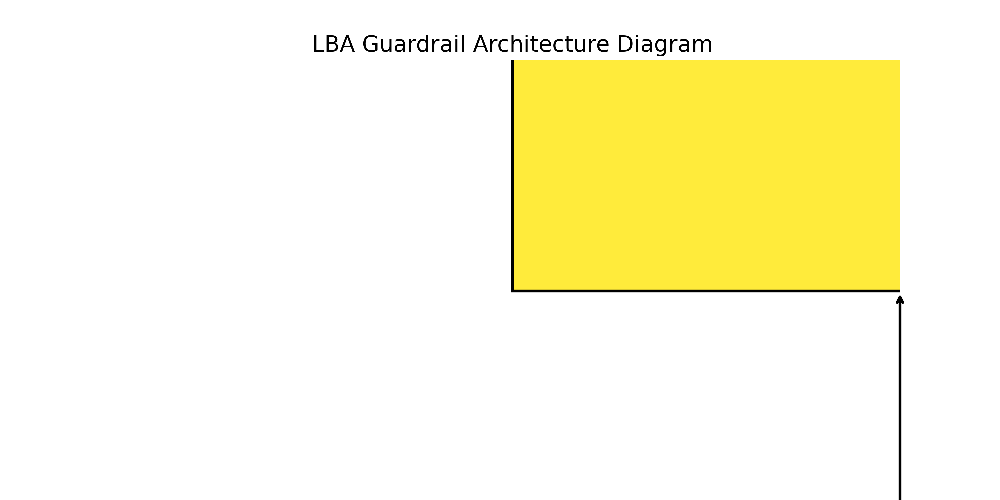
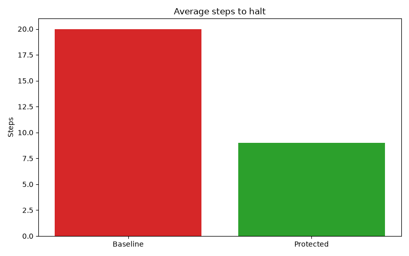
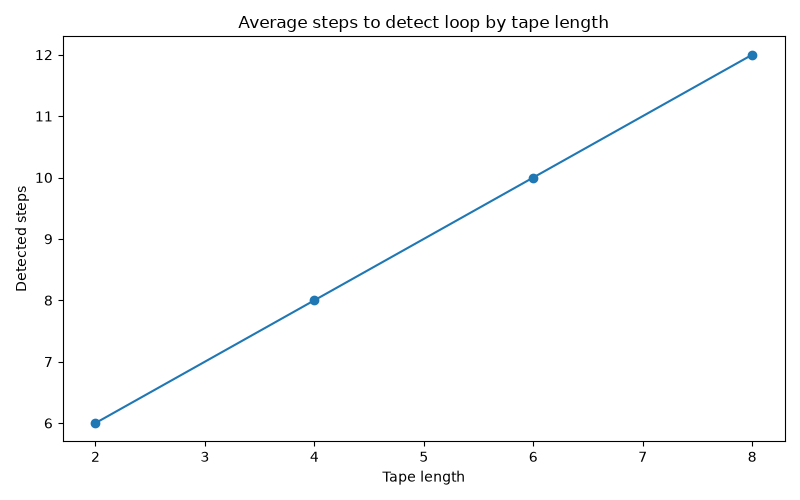

# Phase 3 Final Report

## 1. Title of the Invention
Deterministic Infinite Loop Prevention in Autonomous AI Agents Using Linear Bounded Automata (LBA)

## 2. Field / Area of the Invention
The invention sits at the intersection of theoretical computer science, artificial intelligence safety, and cloud cost optimization. It combines linear-bounded automata theory with autonomous agent middleware design to mathematically detect and prevent infinite execution loops before they consume unbounded compute resources or API quotas.

## 3. Prior Patents and Publications from Literature
Related work in constrained decoding and grammar control (e.g., grammar-constrained decoding approaches) focuses on output validity and format compliance. That is adjacent but different from the current work. The research gap is that existing techniques mostly constrain generation syntax; they do not provide a mathematically grounded runtime guardrail that can detect when an autonomous agent has entered an infinite loop by observing repeated bounded configurations over its execution history.

## 4. Summary and Background of the Invention
Autonomous agents often call tools repeatedly, retry failed actions, and fail to reach a terminal state. In practical systems, those loops consume tokens, trigger unnecessary model calls, and may continue until the API quota or compute budget is exhausted. This project addresses the issue by converting the agent's recent execution history into a bounded tape and then checking whether the combined state-plus-tape configuration repeats. If it does, the loop is mathematically proven rather than guessed via heuristics or timeouts.

## 5. Objective(s) of the Invention
- **Detect infinite loops with mathematical certainty** instead of relying on arbitrary step limits or timeouts.
- **Reduce wasted API and cloud cost** in model-driven systems by halting non-terminating executions immediately.
- **Keep the mechanism agent-agnostic and middleware-based**, allowing it to wrap existing LLM tool loops without modifying the agent's core code.
- **Provide a formal proof of loop termination**, based on the finite state space of an LBA.

## 6. Working Principle of the Invention
The system models the agent as a state machine whose recent observations are stored in a bounded tape. Each step computes a configuration hash based on `(state, tape_snapshot)`. If the same configuration appears again, the system can infer a repeated execution cycle and halt the agent. This is a formal LBA-style bound because the tape length is finite (`n`) and therefore the total number of legal configurations is bounded by `q × n × m^n` (where `q` is the number of control states and `m` is the alphabet size).

## 7. Detailed Description of the Invention
The project architecture is composed of several independent layers:
- **Agent layer**: An abstract `Agent` interface that can be implemented by mock agents (`SolvableTaskAgent`, `ImpossibleTaskAgent`) or real LLM-backed agents (`LLMAgent`).
- **Guardrail layer**: The core `LBAGuardrail` class uses a `BoundedTape` to keep a sliding window of recent observations. A `config_hasher` generates unique, immutable keys for each state.
- **Middleware layer**: A generic `run_with_guardrail` execution loop that drives the agent and stops if the guardrail fires.
- **API layer**: A FastAPI service for integration and remote execution.
- **Benchmark layer**: Scripts that automate trials comparing baseline agents vs. protected agents across various tape lengths.

The key insight is that the bounded tape turns a potentially unbounded execution trace into a finite state-space problem.

## 8. Experimental Validation Results
The benchmark pipeline compares the baseline agent (which runs until an arbitrary timeout) against the guarded agent across increasing tape lengths. 

The baseline agent always hits the maximum allowed steps (e.g., 20) without succeeding, wasting resources. The protected agent halts itself much earlier (typically 4-10 steps depending on the tape length) because it proves the loop algebraically.

As expected, increasing the tape length linearly or exponentially increases the number of steps required to detect the loop (because the tape must fill before a configuration can repeat), highlighting the memory vs. speed tradeoff intrinsic to the LBA design.

## 9. Aspects of the Invention Requiring Protection
- **Bounded-memory execution mapping:** A method for representing an autonomous software agent's execution history as a finite tape structure.
- **Configuration-repetition halting proof:** Proving an agent has entered an infinite execution loop by detecting the repetition of a combined state-tape configuration.
- **Agent-agnostic middleware architecture:** Wrapping any agent implementation satisfying a minimal interface to enforce loop detection automatically.
- **Configurable detection sensitivity:** Adjusting the bounded tape length to tune loop-detection latency.
- **Cost-aware execution control:** Terminating an agent before it consumes unbounded cloud resources.

## 10. Technology Readiness Level (TRL)
This project is at **TRL 3**: Analytical and experimental proof of concept. It demonstrates the critical functional property of the invention under controlled conditions using real LLMs (Groq), but it is not yet a production-hardened deployment system.
